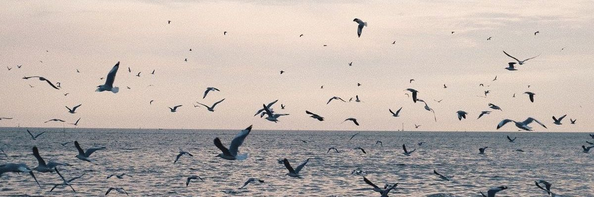

  

**Biomedical Engineering · Medical Image Analysis · Artificial Intelligence**

## 👋 Hi, I'm Golnaz!

I studied Biomedical Engineering and became particularly interested in the intersection of medical imaging and AI.

Over the past few years, I've worked on different problems, including brain tumor analysis, breast lesion detection and segmentation, prostate MRI, and abdominal organ segmentation. I've had the chance to try different architectures, experiment with ideas, and even learn from the experiments that didn't work out. 

---

## 🔬 Research

My research experience has taken me through a few different areas of medical imaging:

**01 — Brain imaging**

Working with MRI data to explore deep learning approaches for brain tumor segmentation.

**02 — Breast imaging**

Exploring breast lesion detection and segmentation using MRI and mammography.

**03 — Prostate imaging**

Working with multiparametric MRI, including T2-weighted, ADC, and diffusion-weighted images.

**04 — Abdominal imaging**

Developing lightweight deep learning architectures for multi-organ segmentation across CT and MRI.

---

## 🌱 My Future Direction

There are still many things I would like to explore. I've been particularly interested in what happens when medical AI models encounter data they haven't seen before.

Some topics I'd love to explore further:

| Area | What interests me |
|---|---|
| Generalization | Improving model performance across different datasets and imaging settings. |
| Adaptation | Adapting models to new data with limited additional training. |
| Foundation models | Exploring their potential for medical image analysis. |
| Vision-language models | Combining visual and textual information for medical applications. |
| Efficient learning | Developing models that require fewer computational and annotation resources. |
| Explainable AI | Understanding model predictions and their reliability. |
| Federated learning | Training models across institutions while preserving data privacy. |

---

## 📚 Publications

A few pieces of research I've been involved in:

- **ICBME 2023** — [Research publication](https://ieeexplore.ieee.org/abstract/document/10488557)
- **Frontiers in Biomedical Technologies** — [Research article](https://fbt.tums.ac.ir/index.php/fbt/article/view/1045)
- **HUSF-Net** — *Towards Efficient Abdominal Multi-Organ Segmentation: A Lightweight Hybrid UNet-SegFormer Network* (manuscript under revision).

---

## ☕ A Little Beyond Research

I love, truly love, reading books. I love getting lost in a story, spending time with its characters, and finding parts of myself in them. My favourite authors, the ones I can always return to, are Dostoevsky, Kafka, Virginia Woolf, Haruki Murakami, Khaled Hosseini, and Jane Austen.

I also love to write about everything, my ideas, thoughts, beliefs, fears, or something I am learning. I have tons of notebooks in my shelf, each for a different purpose. Writing is the most powerful tool for me, a deeper form of thinking; it helps me manage my thoughts, tasks, and even find solutions. So, I spend so much time writing.

---

📖 *Always learning, exploring, and finding new things to read and discover.*

